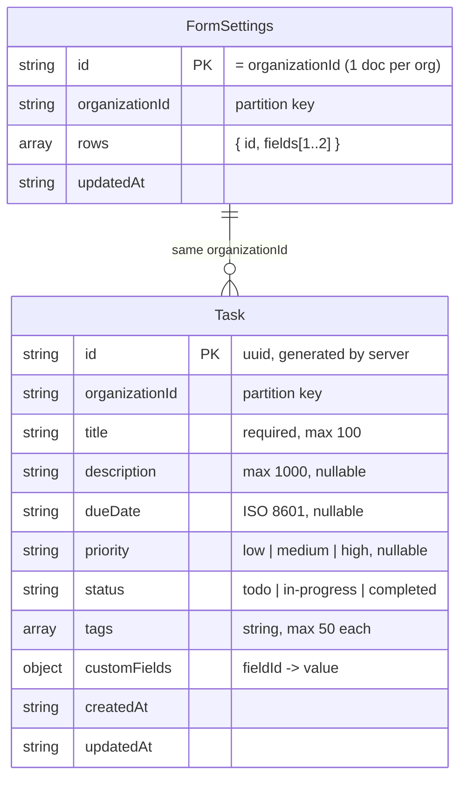

# Task Management API

TypeScript back-end for the Task Management App, built for **Azure Functions (Node 22, v4 programming model)** with **Azure Cosmos DB (NoSQL API)**.

It provides CRUD + bulk delete + search / filter / pagination for tasks, and per-organization **form settings** (customizable task form).

## What was refactored and why

| Original problem | Fix | Where |
|---|---|---|
| Connection string hardcoded (`"this is a connection string"`) | Read from `COSMOS_CONNECTION_STRING`; app fails fast at startup if missing | `src/lib/cosmos.ts` |
| A new `CosmosClient` on every request | One shared client per process (connection reuse) | `src/lib/cosmos.ts` |
| **SQL injection** in `GetTasks` (`'${organizationId}'` inside the query) | Parameterized queries only; `organizationId` must be a UUID | `GetTasks.ts`, `http.ts` |
| `BulkDeleteTasks` used `forEach(async)`: replied `200` before deletes finished, errors swallowed | `Promise.allSettled`, response reports `deleted` and `notFound` | `BulkDeleteTasks.ts` |
| No input validation; client chose `id` / `organizationId` | Strict validation (whitelist of keys, lengths, enums); `id` is a server-generated UUID | `validation.ts`, `InsertTask.ts` |
| `UpdateTask` could overwrite any property (including `id`, `organizationId`) | Whitelisted partial update, read + `replace` with ETag (optimistic concurrency) | `UpdateTask.ts` |
| `GetTasks` used `fetchNext()`: only the first page of results, no real pagination | `OFFSET/LIMIT` + `COUNT` in a single partition, plus search and filters | `GetTasks.ts` |
| No error handling (failures → hangs or raw 500s) | One `handler()` wrapper: 400 / 404 / 409 / 500 with a JSON `{ error }` body; internals never leak | `http.ts` |
| Non-REST routes (`POST` for update, id in query) | `GET/POST /tasks`, `GET/PATCH/DELETE /tasks/{id}`, `POST /tasks/bulk-delete` | `src/functions/*` |
| `strict: false` in tsconfig | `strict: true` | `tsconfig.json` |
| Empty README, no way to run or test | This file, `db:init`, unit tests, smoke test | `README.md`, `scripts/` |
| Outdated dependencies | Updated; `npm audit` reports 0 vulnerabilities | `package.json` |

## Prerequisites

- Node.js **22+**
- [Azure Functions Core Tools v4](https://learn.microsoft.com/azure/azure-functions/functions-run-local): `npm i -g azure-functions-core-tools@4 --allow-scripts=azure-functions-core-tools`
- Docker (for the local Cosmos DB emulator), or a real Azure Cosmos DB account

## Run locally

1. **Start the Cosmos DB emulator** (needs ~2 GB RAM, wait 1–2 min until it is ready):
   ```bash
   docker run -d --name cosmos -p 8081:8081 -p 10250-10255:10250-10255 \
     mcr.microsoft.com/cosmosdb/linux/azure-cosmos-emulator:latest
   curl -sk https://localhost:8081/_explorer/emulator.pem | head -1   # prints -----BEGIN CERTIFICATE----- when ready
   ```
   If the container crashes, run `docker restart cosmos` once.
2. **Configure**: copy `local.settings.example.json` to `local.settings.json` and paste the **Primary Connection String** shown at <https://localhost:8081/_explorer/index.html> (Quickstart tab) into `COSMOS_CONNECTION_STRING`. `local.settings.json` is git-ignored.
3. **Install and create the database**:
   ```bash
   npm install
   npm run db:init      # creates database TaskApp + containers Tasks and FormSettings (partition key /organizationId)
   ```
   (Manual alternative: create them in the emulator's Data Explorer with the same names and partition key.)
4. **Start the API**:
   ```bash
   npm start            # builds with tsc, then `func start` → http://localhost:7071/api
   ```
   Success looks like a list of 8 functions (`GetTasks: [GET] http://localhost:7071/api/tasks` …). A yellow `AzureWebJobsStorage ... Unhealthy` warning is harmless: HTTP functions do not need storage.

**Use a real Azure Cosmos DB instead of the emulator:** put its connection string in `COSMOS_CONNECTION_STRING`, remove the `NODE_TLS_REJECT_UNAUTHORIZED` line, and run `npm run db:init`.

## API

Every request needs `?organizationId=<uuid>` (no authentication is implemented, see Assumptions). Errors always look like `{ "error": "message" }`.

| Method + route | Body | Success | Errors |
|---|---|---|---|
| `GET /api/tasks` · query `page` (default 1), `pageSize` (1–100, default 10), `search`, `status`, `priority` | – | `200 { items, total, page, pageSize }` | 400 |
| `POST /api/tasks` | task | `201` created task | 400 |
| `GET /api/tasks/{id}` | – | `200` task | 400, 404 |
| `PATCH /api/tasks/{id}` | any subset of task fields (≥ 1) | `200` updated task | 400, 404, 409 |
| `DELETE /api/tasks/{id}` | – | `204` | 400, 404 |
| `POST /api/tasks/bulk-delete` | `{ "ids": [uuid, …] }` (1–100) | `200 { deleted, notFound }` | 400 |
| `GET /api/form-settings` | – | `200` settings (default layout if none saved) | 400 |
| `PUT /api/form-settings` | `{ "rows": [...] }` | `200` saved settings | 400 |

Task fields: `title` (required, ≤ 100), `description` (≤ 1000 or null), `dueDate` (ISO date-time or null), `priority` (`low|medium|high` or null), `status` (`todo|in-progress|completed`, default `todo`), `tags` (≤ 20 strings, ≤ 50 chars each), `customFields` (`{ [fieldId]: string }`). `id`, `organizationId`, `createdAt`, `updatedAt` are set by the server and rejected if sent.

```bash
ORG=11111111-1111-4111-8111-111111111111
curl -i -X POST "http://localhost:7071/api/tasks?organizationId=$ORG" \
  -H 'Content-Type: application/json' -d '{"title":"Write README","priority":"high"}'
curl -i "http://localhost:7071/api/tasks?organizationId=$ORG&search=readme&status=todo&page=1&pageSize=10"
curl -i -X PATCH "http://localhost:7071/api/tasks/<id>?organizationId=$ORG" \
  -H 'Content-Type: application/json' -d '{"status":"completed"}'
curl -i -X DELETE "http://localhost:7071/api/tasks/<id>?organizationId=$ORG"
curl -i "http://localhost:7071/api/form-settings?organizationId=$ORG"
```

HTTP status meaning: `400` invalid input · `404` not found · `409` task changed by someone else (ETag mismatch), reload and retry · `500` unexpected error (details only in the server log).

## Data model

Database `TaskApp`, containers `Tasks` and `FormSettings`, both partitioned by `/organizationId`.



Why these choices:
- **Partition key `/organizationId`**: every query is scoped to one organization, so all queries are single-partition (fast, cheap).
- **FormSettings: one document per organization, `id = organizationId`**: read with a point read (~1 RU), written with `upsert`.
- **`customFields` keyed by field id, not label**: renaming a field in the form settings never touches task data.
- Schemas: `task.schema.json`, `form-settings.schema.json`.

## Form settings rules (enforced by the API, not only the UI)

- Rows: 1–200. Fields per row: 1–2 (max two columns). Field ids are unique.
- The six **built-in fields** (`title`, `description`, `status`, `priority`, `dueDate`, `tags`) must always exist: they can be renamed and reordered, never removed, and their type is fixed.
- **Custom fields** can be renamed, reordered and removed; type is `text`, `date`, `datetime` or `email`.

## Assumptions

- No authentication is required. `organizationId` is supplied by the client and validated as a UUID.
- Runs fully locally with the Azure Cosmos DB Emulator.
- Form settings are stored per organization. New fields are appended at the end of the form by default (can be reordered afterwards).

## Testing

```bash
npm test                                                   # unit tests (validators), no database needed
BASE_URL=http://localhost:7071/api bash scripts/smoke.sh   # end-to-end test against the running API + emulator
node scripts/cleanup-org.mjs <organizationId>              # removes test data of one organization
```
`smoke.sh` prints `PASS`/`FAIL` per check and ends with `ALL CHECKS PASSED` (exit code 0) or `N CHECK(S) FAILED` (exit code 1). Use `ORG=<uuid>` to choose the test organization.

## Known limitations and next steps

- No authentication/authorization: next step is Microsoft Entra ID, deriving `organizationId` from the token instead of the query string.
- Custom field values are not type-checked against the form settings on write (would cost an extra read per write).
- `OFFSET/LIMIT` gets more expensive on very deep pages; switch to continuation tokens if lists grow large.
- No rate limiting or CI pipeline yet.
